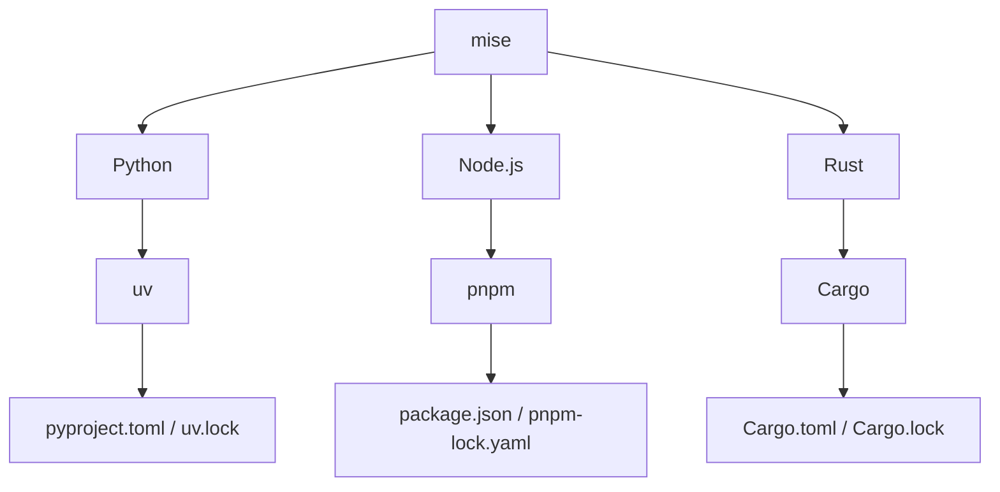
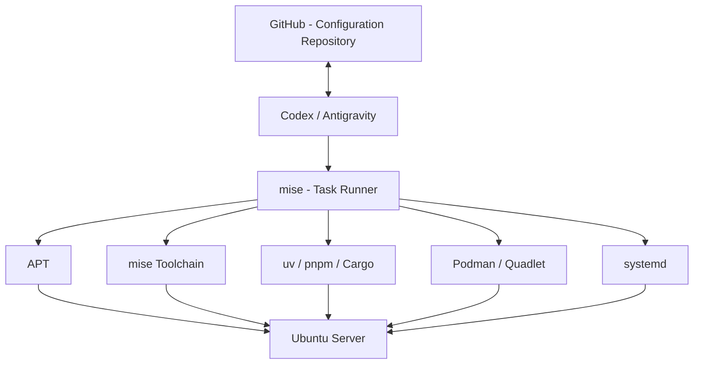
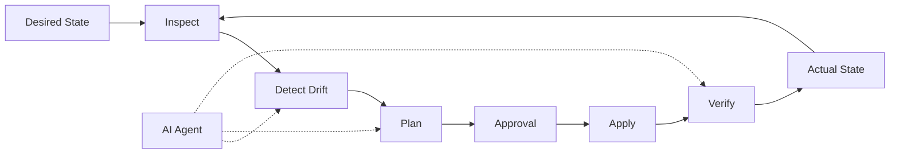

# From a 2015 MacBook Pro to an Agent-Native Linux Server

*Repurposing an old laptop into an always-on, AI-managed personal computing node.*

A laptop that was considered professional-grade hardware in 2015 is remarkably modest by today's standards. However, with the rise of cloud-based AI agents, an old computer can still serve a useful purpose without performing AI inference itself.

Instead of retiring my old MacBook Pro, I decided to turn it into a dedicated, headless Linux machine managed by AI agents.

## 1. The Hardware

The machine is a 13-inch Early 2015 MacBook Pro (A1502 / MacBookPro12,1).

| Component        | Specification               |
| ---------------- | --------------------------- |
| CPU              | Intel Core i5-5257U, 2.7GHz |
| Cores / Threads  | 2 / 4                       |
| RAM              | 8GB LPDDR3                  |
| GPU              | Intel Iris Graphics 6100    |
| Architecture     | x86-64                      |
| Wi-Fi            | Broadcom BCM43602           |
| Battery health   | 87.24%                      |
| Battery capacity | 65.35 Wh                    |
| Charge cycles    | 656                         |

Despite its age, it has sufficient computing power for lightweight containers, background services, development tools and AI agent orchestration.

Its built-in battery also provides a useful form of backup power.

## 2. Choosing the Operating System

I considered three Linux distributions:

| OS                      | Strength                                      | Trade-off                                   |
| ----------------------- | --------------------------------------------- | ------------------------------------------- |
| Debian 13               | Minimal, stable and predictable               | Smaller ecosystem of vendor-specific guides |
| NixOS                   | Declarative configuration and system rollback | Learning curve and binary compatibility     |
| Ubuntu Server 26.04 LTS | Broad software support and modern packages    | Additional default tooling                  |

NixOS was particularly attractive because its entire system configuration could be version-controlled through GitHub.

However, since an AI agent will be responsible for managing the machine, declarative management does not necessarily need to be an operating system feature.

Native configuration files, deterministic scripts and automated drift detection can achieve many of the same management objectives.

I ultimately chose **Ubuntu Server 26.04 LTS**, prioritising:

- Compatibility with third-party software and AI agents.
- Modern packages and Linux kernel.
- Long-term security support.
- Extensive documentation and community support.
- Conventional Linux architecture.

There is little reason to introduce another abstraction layer if existing Linux tools can already accomplish the task.

## 3. Installing Ubuntu Server

Download the AMD64 installation image from the [Ubuntu Server website](https://ubuntu.com/download/server).

On macOS, identify the USB drive:

```bash
diskutil list external physical
```

Unmount and flash the installation image:

```bash
diskutil unmountDisk /dev/disk4

sudo dd \
  if="$HOME/Downloads/ubuntu-26.04.1-live-server-amd64.iso" \
  of=/dev/rdisk4 \
  bs=4m

sync
diskutil eject /dev/disk4
```

Replace the ISO filename and disk identifier with the actual values. This operation erases the selected USB drive.

Restart the MacBook while holding the Option (⌥) key and select **EFI Boot**.

My recommended installation configuration is:

| Setting               | Selection                    |
| --------------------- | ---------------------------- |
| Installation type     | Ubuntu Server (minimized)    |
| Network               | Continue without network     |
| Storage               | Traditional ext4 without LVM |
| SSH                   | Install OpenSSH Server       |
| Ubuntu Pro            | Skip                         |
| Featured Server Snaps | None                         |
| Desktop environment   | None                         |

**Do not configure Wi-Fi on the installation page.**

The Broadcom wireless adapter on this MacBook can encounter driver and firmware issues. I recommend completing the installation offline and configuring Wi-Fi manually afterwards.

The installation replaces macOS entirely, so back up important data beforehand.

## 4. Configuring and Troubleshooting Wi-Fi

The MacBook uses a Broadcom BCM43602 wireless adapter, supported by the Linux `brcmfmac` driver.

### Identify the wireless interface

After installing Ubuntu, log in and run:

```bash
ip -br link
```

On my MacBook, the wireless interface is:

```text
wlp3s0
```

Check the wireless chipset and driver:

```bash
lspci -nnk | grep -A 4 -i network
```

Load the driver if necessary:

```bash
sudo modprobe brcmfmac
sudo rfkill unblock wifi
```

Check whether WPA Supplicant is already available:

```bash
which wpa_supplicant
```

If the wireless firmware or required networking tools are missing, temporarily connect through a USB Ethernet adapter or supported USB tethering and install them:

```bash
sudo apt update

sudo apt install -y \
  linux-firmware-broadcom-wireless \
  wpasupplicant \
  iw
```

### Configure Wi-Fi using Netplan

Ubuntu Server uses Netplan for declarative network configuration.

Create a dedicated configuration file:

```bash
sudo nano /etc/netplan/99-wifi.yaml
```

Add the following configuration:

```yaml
network:
  version: 2
  renderer: networkd
  wifis:
    wlp3s0:
      dhcp4: true
      optional: true
      access-points:
        "YOUR_WIFI_SSID":
          password: "YOUR_WIFI_PASSWORD"
```

Replace the interface name, SSID and password as appropriate. Check existing Netplan files for conflicting wireless configuration.

Restrict access to the configuration file and apply it:

```bash
sudo chmod 600 /etc/netplan/99-wifi.yaml

sudo netplan generate
sudo netplan try
```

Confirm the configuration when prompted.

Verify connectivity:

```bash
ip -br addr

ping -c 4 1.1.1.1
ping -c 4 google.com
```

Do not commit the Wi-Fi password to GitHub.

### Broadcom suspend and resume issue

Another problem I encountered was that the wireless driver stopped responding after closing and reopening the MacBook lid.

The console repeatedly displayed:

```text
brcmf_msgbuf_query_dcmd:
  Timeout on response for query command

brcmf_run_escan: error (-5)

brcmf_cfg80211_scan: scan error (-5)
```

The wireless interface remained visible, but the driver could no longer scan for networks.

If the kernel messages overwhelm the terminal, temporarily suppress console logging:

```bash
sudo dmesg -n 1
```

This does not repair the driver or remove the kernel logs.

Since the machine is intended to operate as a headless server, the practical workaround is to disable suspend entirely and reboot.

This avoids the suspend/resume failure path rather than fixing the underlying Broadcom driver. Persistent wireless failures may still require further investigation or a wired network connection.

## 5. Making the MacBook Headless

Create a systemd configuration directory:

```bash
sudo mkdir -p /etc/systemd/logind.conf.d
```

Create `/etc/systemd/logind.conf.d/99-headless.conf`:

```ini
[Login]
HandleLidSwitch=ignore
HandleLidSwitchExternalPower=ignore
HandleLidSwitchDocked=ignore
IdleAction=ignore
```

Additionally, disable system sleep:

```bash
sudo mkdir -p /etc/systemd/sleep.conf.d
```

Create `/etc/systemd/sleep.conf.d/99-headless.conf`:

```ini
[Sleep]
AllowSuspend=no
AllowHibernation=no
AllowSuspendThenHibernate=no
AllowHybridSleep=no
```

Ensure the system boots into headless mode:

```bash
sudo systemctl set-default multi-user.target
sudo systemctl enable --now ssh
sudo reboot
```

After rebooting, connect through SSH and test whether the connection remains active when the lid is closed.

The intended behaviour is:

| Event                    | Behaviour                         |
| ------------------------ | --------------------------------- |
| Lid closed               | Continue running                  |
| Lid opened               | No resume cycle required          |
| Idle system              | Remain online                     |
| SSH disconnected         | Background services remain active |
| Mains power disconnected | Continue running on battery       |

## 6. Power and Battery Management

One advantage of repurposing a laptop rather than a conventional desktop is its built-in battery.

Install the monitoring tools:

```bash
sudo apt install -y \
  upower \
  lm-sensors \
  mbpfan
```

Enable the MacBook fan control daemon:

```bash
sudo systemctl enable --now mbpfan
```

Inspect the battery:

```bash
upower -i "$(upower -e | grep battery | head -1)"
```

My MacBook reported the following:

| Metric            | Value    |
| ----------------- | -------- |
| Original capacity | 74.90 Wh |
| Current capacity  | 65.35 Wh |
| Battery health    | 87.24%   |
| Charge cycles     | 656      |
| Temperature       | 29.2°C   |

Not bad for a machine originally released in 2015.

### Automatic shutdown during power failure

Configure the existing settings in `/etc/UPower/UPower.conf`:

```ini
UsePercentageForPolicy=true
PercentageLow=20
PercentageCritical=15
PercentageAction=10
CriticalPowerAction=PowerOff
```

Restart UPower:

```bash
sudo systemctl restart upower
```

This policy is intended to trigger a graceful shutdown when the battery reaches 10%, reducing the risk of abrupt power loss and data corruption. Its behaviour should be tested before relying on it.

### Battery charging limit

Ideally, an always-connected laptop should have a configurable charging limit.

Check whether the hardware exposes this functionality:

```bash
ls /sys/class/power_supply/BAT*/ | grep threshold
```

Unfortunately, my MacBook does not expose the standard Linux charging threshold interface.

For now, I prefer to retain the existing charging controller rather than introduce a custom kernel module solely to limit charging to 80%.

Battery condition, ventilation and temperature should also be checked regularly before leaving an old laptop permanently connected to power.

## 7. Installing Essential Tools and Remote Access

Update the system and install the essential management tools:

```bash
sudo apt update
sudo apt upgrade -y

sudo apt install -y \
  git curl wget \
  tmux btop jq \
  ripgrep unzip \
  ca-certificates \
  build-essential \
  openssh-server \
  podman
```

Find the machine's IP address:

```bash
hostname -I
```

Connect from another computer:

```bash
ssh username@192.168.1.100
```

For access outside the local network, [Tailscale](https://tailscale.com/) can provide a private network without exposing SSH directly to the internet.

SSH key authentication is recommended for long-term operation.

To maintain an interactive agent session after disconnecting:

```bash
tmux new -s agent
```

Detach using `Ctrl+B`, followed by `D`.

Reconnect later:

```bash
tmux attach -t agent
```

For persistent rootless Podman and systemd user services:

```bash
sudo loginctl enable-linger "$USER"
```

## 8. Installing mise and Managing the Development Environment

One of my objectives is to keep the machine's development environment flexible, reproducible and easy for an AI agent to manage.

Rather than installing every programming language through APT or maintaining separate runtime managers such as nvm and pyenv, I use [mise](https://mise.jdx.dev/) as the unified toolchain manager.

This follows my broader development environment philosophy:

**Rolling Toolbox, Pinned Workspace.**

The machine can have a regularly updated global toolbox, while individual projects retain their own versioned development environments.

### Install mise

Run the official installer as a regular user:

```bash
curl -fsSL https://mise.run | sh
```

As with any remote installation script, review its contents before executing it.

Verify the installation:

```bash
~/.local/bin/mise --version
```

### Activate mise in Bash

Ubuntu Server uses Bash by default. Add mise activation to the shell configuration:

```bash
echo 'eval "$(~/.local/bin/mise activate bash)"' >> ~/.bashrc

source ~/.bashrc
```

Verify that mise is available:

```bash
mise --version
mise doctor
```

There is no need to prefix every interactive command with `mise exec`. Shell activation automatically makes the configured tools available through the normal command-line interface.

### Install the global toolbox

Set up the machine's default development tools:

```bash
mise use -g python@latest
mise use -g node@lts
mise use -g rust@stable
mise use -g uv@latest
mise use -g pnpm@latest
```

Verify the tools:

```bash
python --version
node --version
rustc --version
cargo --version
uv --version
pnpm --version
```

List all managed tools:

```bash
mise ls
```

The global configuration is stored in:

```text
~/.config/mise/config.toml
```

It can also be edited directly:

```toml
[tools]
python = "3.13"
node = "lts"
rust = "stable"
uv = "latest"
pnpm = "latest"
```

After editing the configuration, run:

```bash
mise install
```

The global toolbox intentionally follows release channels or version ranges rather than permanently freezing every tool.

### Pin project-specific environments

Each project can define its own `mise.toml`:

```toml
[tools]
python = "3.13"
node = "24"
rust = "stable"
uv = "latest"
pnpm = "latest"
```

Inside the project directory:

```bash
mise install
```

Where exact reproducibility is required, generate a lockfile:

```bash
mise lock
```

Commit both `mise.toml` and `mise.lock` to Git.

Version ranges and aliases in `mise.toml` alone do not guarantee identical tool versions across machines. The lockfile records the resolved versions.

### Keep native package managers

mise does not replace Python, JavaScript or Rust package management.

Each project should continue to use its ecosystem's native configuration files:

| Ecosystem          | Package manager | Configuration                    |
| ------------------ | --------------- | -------------------------------- |
| Python             | uv              | `pyproject.toml`, `uv.lock`      |
| JavaScript         | pnpm            | `package.json`, `pnpm-lock.yaml` |
| Rust               | Cargo           | `Cargo.toml`, `Cargo.lock`       |
| Runtime management | mise            | `mise.toml`, `mise.lock`         |

This ensures that developers who do not use mise can still work with the project.



### Install the AI agent

With Node.js and npm available through mise, Codex CLI can be installed without modifying the system Python or Node.js environment:

```bash
npm install -g @openai/codex
```

Launch Codex:

```bash
codex
```

Complete the authentication process using the supported login flow.

Antigravity can be added as an alternative agent using its official installation instructions.

Both agents should operate as regular users, with privileged system changes requiring explicit approval.

### Non-interactive execution

Interactive Bash activation is convenient, but systemd services and automated jobs do not necessarily load `.bashrc`.

For these environments, use explicit execution:

```bash
~/.local/bin/mise exec -- node --version
```

Or invoke a configured task:

```bash
~/.local/bin/mise run verify
```

For systemd services, specify the correct working directory, service user and executable path.

This distinction is particularly important for an unattended, agent-managed server.

## 9. Building a Minimal Software Stack

Rather than introducing another infrastructure management framework, I want to rely on native Linux tools and existing package managers.

| Tool                | Responsibility                            |
| ------------------- | ----------------------------------------- |
| APT                 | System packages                           |
| mise                | Runtime management and task orchestration |
| uv                  | Python packages and environments          |
| pnpm                | JavaScript packages                       |
| Cargo               | Rust packages                             |
| Podman              | Rootless containers                       |
| Quadlet             | Declarative container services            |
| systemd             | Service lifecycle and scheduling          |
| GitHub              | Configuration source of truth             |
| Tailscale / SSH     | Remote access                             |
| Codex / Antigravity | AI-assisted system administration         |

Each tool retains its native configuration format.

There is no requirement for Ansible, Terraform, Nix or a custom configuration language.



## 10. Towards Agent-Native Computing

The next step is to maintain the machine's desired configuration in a GitHub repository, with mise providing a consistent management interface.

The proposed management repository would contain native configuration files rather than a new configuration language.

```text
machine-config/
├── AGENTS.md
├── README.md
├── mise.toml
├── mise.lock
├── system/
│   ├── packages.txt
│   └── etc/
├── home/
├── containers/
├── services/
└── scripts/
    ├── inspect.sh
    ├── plan.sh
    ├── apply.sh
    └── verify.sh
```

mise provides a convenient way to expose management operations without developing a custom CLI.

For example, the management repository's `mise.toml` could contain:

```toml
[tasks.inspect]
description = "Inspect the current machine state"
run = "bash scripts/inspect.sh"

[tasks.plan]
description = "Detect configuration drift"
run = "bash scripts/plan.sh"

[tasks.apply]
description = "Apply approved configuration"
run = "bash scripts/apply.sh"

[tasks.verify]
description = "Verify system health"
run = "bash scripts/verify.sh"
```

Once the corresponding scripts are implemented, the management workflow becomes:

```bash
mise run inspect
mise run plan
mise run apply
mise run verify
```

Deterministic scripts inspect the actual system state, detect configuration drift and apply approved changes.

AI agents investigate unexpected problems, propose improvements and develop new automation when necessary.



Privileged changes should require approval rather than giving the agent unrestricted root access. Repository access, deployment permissions and secrets must also be managed independently.

This approach does not provide the atomic system upgrades or built-in rollback capabilities of NixOS, but it preserves compatibility with conventional Linux software while enabling incremental adoption of declarative management.

Most importantly, the agent should develop reusable automation rather than consume tokens repeatedly performing predictable administrative tasks.

## Conclusion

An eleven-year-old laptop is no longer competitive as an AI inference machine, but it can still become a useful AI-managed computing node.

It already provides several useful capabilities:

- An x86-64 Linux computing environment.
- 8GB of memory for lightweight workloads.
- Built-in battery backup.
- Remote access through SSH.
- A unified development environment managed by mise.
- A platform for containers and AI agent orchestration.

The underlying philosophy is simple:

**Native Configuration. Agentic Orchestration. Deterministic Execution.**

The operating system provides capabilities.

Git defines the desired state.

mise provides a consistent operational interface.

Conventional software enforces the configuration.

AI agents handle the problems that cannot be predetermined.

Rather than building an entirely new agent-native operating system, perhaps we can start by making existing operating systems agent-native.

## References

- [Ubuntu Server](https://ubuntu.com/download/server)
- [Ubuntu Server Network Configuration](https://ubuntu.com/server/docs/configuring-networks/)
- [Netplan Documentation](https://netplan.readthedocs.io/)
- [Linux Broadcom Wireless Drivers](https://wireless.docs.kernel.org/en/latest/en/users/drivers/brcm80211.html)
- [mise](https://mise.jdx.dev/)
- [mise Getting Started](https://mise.en.dev/getting-started)
- [Hello mise — Reference Repository](https://github.com/cenzwong/hello-mise)
- [uv](https://docs.astral.sh/uv/)
- [pnpm](https://pnpm.io/)
- [Podman](https://podman.io/)
- [OpenAI Codex](https://github.com/openai/codex)
- [Google Antigravity](https://antigravity.google/)
- [Tailscale](https://tailscale.com/)
