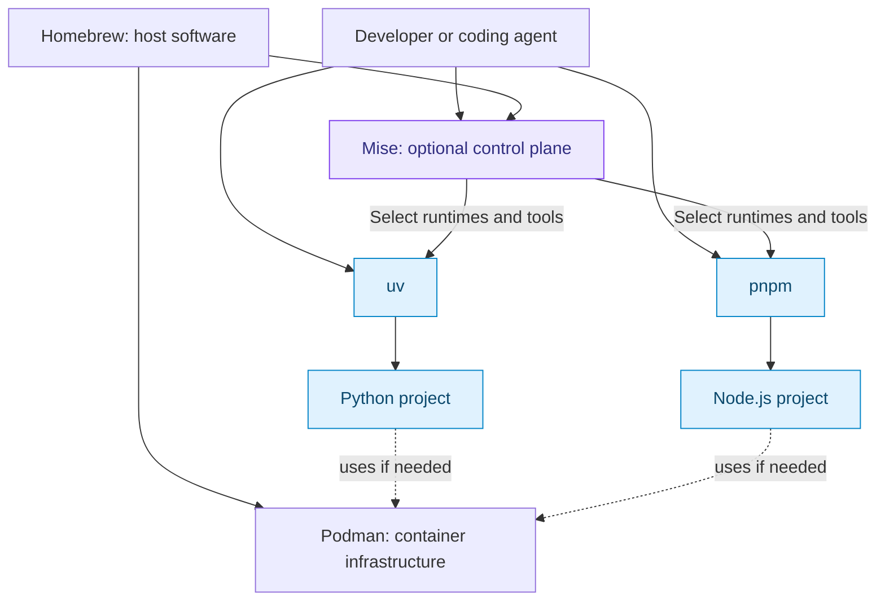
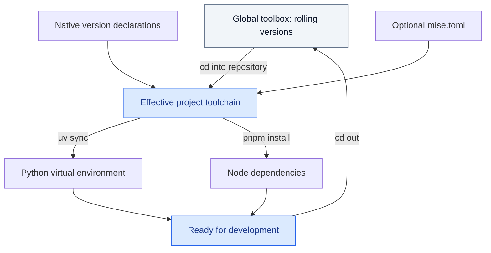
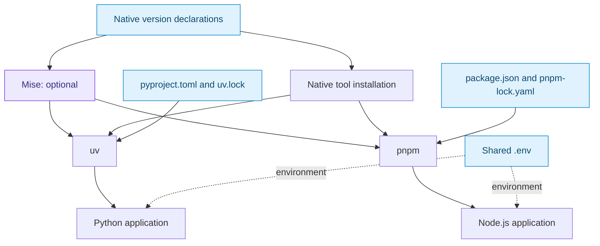
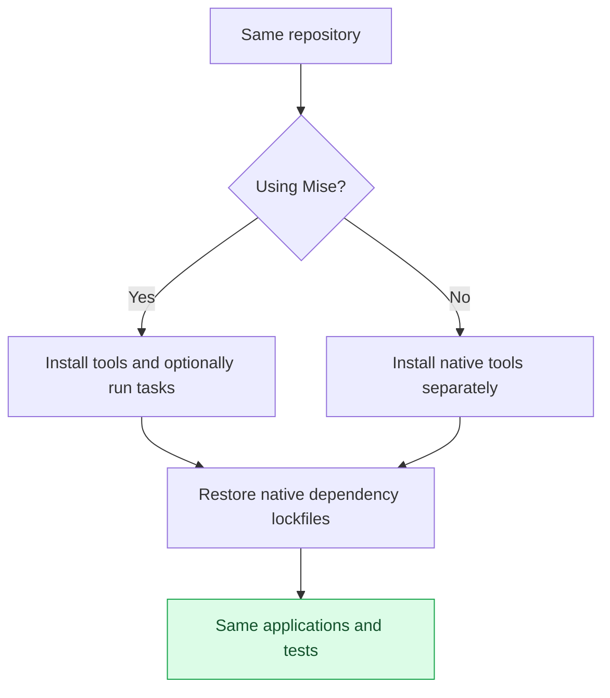

# Rolling Toolbox, Pinned Workspace

*A native-first macOS development environment for humans and AI coding agents, using Homebrew, Mise, uv, pnpm and Podman.*

A good developer environment is not defined by having the fewest package managers. It is defined by clear ownership, predictable execution and reproducible projects.

I want my personal tools to evolve without accidentally changing the projects I work on. I want to enter a repository and have the right tools available, without prefixing every command with another command. And I want a colleague who has never installed Mise to be able to work on the same repository.

I call this approach **Rolling Toolbox, Pinned Workspace**. My preferred implementation is **Mode A+**. These are my names for the approach, not industry standards.

The complete Python and Node.js reference implementation is available at **[github.com/cenzwong/hello-mise](https://github.com/cenzwong/hello-mise)**.

## 1. One responsibility, one owner

| Layer | Preferred owner | Examples |
| --- | --- | --- |
| Host software and native libraries | Homebrew | Git, Mise, desktop apps |
| Language runtimes and standalone CLIs | Mise | Python, Node.js, kubectl, Copilot |
| Python project dependencies and environments | uv | FastAPI, NumPy, pytest, `.venv` |
| JavaScript and TypeScript dependencies | pnpm | React, Vite, TypeScript |
| Infrastructure and container isolation | Podman | PostgreSQL, Redis, Linux workloads |



Mise is my preferred management interface, not a replacement for every package manager. The application remains independent of my personal tooling. Different scopes may legitimately use different versions; Homebrew's internal Python dependencies can coexist with a Mise-managed interpreter.

## 2. Homebrew manages the host

On macOS, I install foundational software through Homebrew:

```bash
brew install mise git gh podman
```

A `Brewfile` records the host inventory:

```ruby
brew "mise"
brew "git"
brew "gh"
brew "podman"
```

Restore it with `brew bundle --file=Brewfile`. This is an inventory, not an exact version lockfile. Homebrew also updates Mise itself. I do not remove libraries required by other formulae or install application dependencies into the Homebrew prefix.

## 3. Mise manages the rolling toolbox

Enable interactive activation once in `~/.zshrc`:

```zsh
eval "$(mise activate zsh)"
```

Optionally add shims to `~/.zprofile` for processes inheriting the login shell's PATH:

```zsh
eval "$(mise activate zsh --shims)"
```

Open a new terminal. Interactive activation updates the shell environment; shims select executables but do not load the entire project environment. Neither guarantees that a GUI application or independent agent process inherits my shell configuration.

I install personal tools with one command family:

```bash
mise use -g python@latest uv@latest node@lts pnpm@latest
mise use -g kind@latest
mise use -g npm:@github/copilot@latest
mise use -g pypi:mlx-lm@latest
```

The global configuration at `~/.config/mise/config.toml` can also be edited directly:

```toml
[tools]
python = "latest"
node = "lts"
uv = "latest"
pnpm = "latest"
kind = "latest"
# Set kubectl to a version compatible with the target cluster.
"npm:@github/copilot" = "latest"
"pypi:mlx-lm" = "latest"
"pypi:mlx-whisper" = "latest"
"pypi:ruff" = "latest"
"pypi:pip-audit" = "latest"

[settings]
minimum_release_age = "24h"
idiomatic_version_file_enable_tools = ["python", "node", "pnpm"]
python.uv_venv_auto = "source"
```

This is an illustrative inventory; I only install tools I need. Node follows LTS, Python follows compatible stable releases, and cluster clients must respect the supported version skew. MLX tools may require Apple Silicon and particular Python versions.

The PyPI backend can delegate installation to uv, keeping standalone tools separate from project environments. I avoid duplicate persistent installations through `pipx`, `uv tool`, `npm install -g` and Homebrew when Mise already owns that CLI. Existing installations need deliberate migration.

Update deliberately rather than automatically on every terminal launch:

```bash
mise upgrade --global --dry-run
mise upgrade --global
```

`latest` and `lts` are requests, not promises of automatic updates.

## 4. A pinned workspace, without tool lock-in

When I enter a project, Mise discovers applicable configuration in the directory and its ancestors. Project-specific requests override matching global defaults; unrelated global tools remain available. Leaving the directory restores the applicable outer environment. This is convenient scope selection, not a hermetic sandbox.



My important design decision is **native first, Mise enhanced**. Instead of duplicating Python and Node versions in `mise.toml`, I keep version declarations in files other developers can already use. Mise's opt-in idiomatic version-file support reads them.

| File | Responsibility |
| --- | --- |
| `.python-version` | Selected Python development version |
| `.node-version` | Selected Node.js development version |
| `pyproject.toml` / `uv.lock` | Python metadata, compatibility and resolved dependencies |
| `package.json` / `pnpm-lock.yaml` | Node compatibility, scripts, pnpm version and resolved dependencies |
| `.env.example` / `.env` | Shared configuration template / local values |
| `mise.toml` | Optional toolchain integration and tasks |
| `mise.lock` | Additional resolved Mise toolchain metadata, when generated |

A compatibility range is not an exact runtime pin. For example, `requires-python = ">=3.13,<3.14"` describes supported interpreters, whereas `.python-version` selects a development interpreter. Likewise, Node's `engines` is a compatibility declaration, not Mise's runtime selector.

I commit the native manifests, version files and lockfiles, and the shared Mise configuration if present. I ignore `.env`, `.venv/`, `node_modules/`, `mise.local.toml`, `mise.local.lock` and applicable local lock sidecars. For tools without a suitable native version declaration, I can specify an exact version directly in `mise.toml` and document the equivalent manual installation.

## 5. Reference implementation: Hello Mise

The [reference repository](https://github.com/cenzwong/hello-mise) contains two small applications using only their standard libraries. Both print a greeting based on `HELLO_NAME`.

```text
hello-mise/
├── .python-version
├── .node-version
├── .env.example
├── .gitignore
├── pyproject.toml
├── uv.lock
├── package.json
├── pnpm-lock.yaml
├── mise.toml
├── hello.py
├── hello.mjs
├── tests/
│   ├── test_hello.py
│   └── hello.test.mjs
└── README.md
```

The starter selects Python `3.13.5` and Node `22.16.0` in their respective version files. These are demonstration pins, not recommendations for current security patch levels.

The Python manifest is ordinary Python project configuration:

```toml
[project]
name = "hello-mise"
version = "0.1.0"
description = "A native-first Python and Node.js Hello World"
requires-python = ">=3.13,<3.14"
dependencies = []
```

The Node manifest keeps the scripts and package manager declaration:

```json
{
  "name": "hello-mise",
  "version": "0.1.0",
  "private": true,
  "type": "module",
  "packageManager": "pnpm@10.15.0",
  "engines": { "node": ">=22 <23" },
  "scripts": {
    "start": "node --env-file=.env hello.mjs",
    "test": "node --test tests/hello.test.mjs"
  }
}
```

Here is the integration from the repository's `mise.toml`:

```toml
[tools]
uv = "0.10.0"

[settings]
idiomatic_version_file_enable_tools = ["python", "node", "pnpm"]
python.uv_venv_auto = "source"

[env]
_.file = ".env"
UV_PYTHON = { value = "{{ tools.python.path }}", tools = true }
UV_PYTHON_DOWNLOADS = "never"
```

Mise reads the native Python, Node and pnpm version declarations. uv creates and manages `.venv`; Mise activates it once it exists. The environment settings direct uv to the selected Mise Python and prevent additional interpreter downloads in this workflow. Without Mise, uv can select or install Python itself. This is why I do not put a mandatory `python-downloads = "never"` restriction in the shared `pyproject.toml`.

The `.env` file remains ordinary application configuration. Python can load it through `uv run --env-file`; Node can load it through `node --env-file`. The application does not need to know about Mise.



## 6. Three ways to use the same repository

```bash
git clone https://github.com/cenzwong/hello-mise.git
cd hello-mise
cp .env.example .env
```

### A. Without Mise

Install uv, Node `22.16.0` and pnpm `10.15.0` through your preferred installers. uv can install the Python interpreter specified by `.python-version`.

```bash
uv sync --locked
pnpm install --frozen-lockfile

uv run --locked --env-file .env hello.py
pnpm start

uv run --locked python -m unittest discover -s tests -p 'test_*.py'
pnpm test
```

For this dependency-free Node example, `node --env-file=.env hello.mjs` also works directly.

### B. With Mise, using native commands

Review the configuration before trusting the repository:

```bash
mise trust
mise install
```

In an activated interactive shell, after the prompt refreshes:

```bash
uv sync --locked
pnpm install --frozen-lockfile
```

Once the environment has activated at the next prompt:

```bash
python hello.py
node hello.mjs
```

No repeated `mise exec --` prefix or manual `.venv` activation is required. Ordinary directory changes select the environment; they are not a substitute for installing dependencies. Use `uv run --locked` for explicit lock validation and environment synchronisation, and declared pnpm scripts for project commands.

### C. With Mise task shortcuts

The reference configuration adds:

```toml
[tasks.setup]
description = "Restore Python and Node dependencies"
run = ["uv sync --locked", "pnpm install --frozen-lockfile"]

[tasks.hello]
description = "Run both Hello World applications"
run = ["uv run --locked --env-file .env hello.py", "pnpm start"]

[tasks.test]
description = "Run both native test suites"
run = ["uv run --locked python -m unittest discover -s tests -p 'test_*.py'", "pnpm test"]
```

After `mise trust` and `mise install`:

```bash
mise run setup
mise run hello
mise run test
```

These tasks are optional shortcuts for humans, CI and agents, not a new build system. In a non-interactive shell, an explicit `mise exec -- uv run --locked --env-file .env hello.py` is useful when shell activation cannot be assumed.

With `HELLO_NAME=London` in `.env`, both approaches should produce:

```text
Hello, London! (Python)
Hello, London! (Node.js)
```

Unset any competing exported `HELLO_NAME` before comparing results, since dotenv precedence can differ. Never commit a local `.env` containing secrets.

## 7. Starting a new project

I prefer writing configuration directly, rather than making a series of tool-specific `mise use --pin` calls. These are illustrative fresh-project commands; choose reviewed versions for your own project.

### Python

```bash
mkdir my-python-app && cd my-python-app
uv init --python 3.13.5
uv python pin 3.13.5
```

Add the Python-specific subset of the reference `mise.toml` (enable only `python`, retain the uv pin and interpreter settings). Omit the dotenv directive until the file exists, and omit unrelated tasks. Review and trust it, then run `mise install` if using Mise. After shell activation, add dependencies in the native way:

```bash
uv add fastapi
uv add --dev pytest ruff
uv sync
uv lock --check
```

### JavaScript or TypeScript

```bash
mkdir my-web-app && cd my-web-app
printf '22.16.0\n' > .node-version
pnpm init
```

Set `packageManager` to `pnpm@10.15.0` in `package.json` (or your reviewed version), and set `engines.node` to the supported range. Add optional Mise configuration enabling `node` and `pnpm` idiomatic version files. Select the declared tools, then:

```bash
pnpm add -D typescript vitest
pnpm exec tsc --init
```

Commit the resulting native manifests, versions and lockfiles. No custom project generator is necessary.

## 8. Installing a tool is not installing a dependency

A personal CLI and an application dependency have different lifecycles.

```bash
# Personal utility
mise use -g pypi:ruff@latest

# Project dependency
uv add --dev ruff
uv run --locked ruff check .

# JavaScript project dependency
pnpm add -D prettier
pnpm exec prettier --check .
```

Even when I have pytest installed globally, a project that uses it must declare it. The same applies to libraries imported by application code: a global `mlx-lm` installation does not make its modules part of a project's virtual environment. Native execution commands can still encounter inherited PATH entries, so declare every build- or test-critical dependency.

| Intent | Command |
| --- | --- |
| Host software | `brew install` |
| Personal runtime or CLI | `mise use -g` |
| Project toolchain | Edit native version files or `mise.toml`, then `mise install` |
| Python dependency / dev dependency | `uv add` / `uv add --dev` |
| JavaScript dependency / dev dependency | `pnpm add` / `pnpm add -D` |
| Temporary reviewed utility | `uvx` / `pnpm dlx` |
| Restore locked dependencies | `uv sync --locked` / `pnpm install --frozen-lockfile` |

## 9. Reproducibility, CI and the removal test

Exact runtime pins and dependency lockfiles protect the workspace from global tool updates. For additional toolchain resolution and integrity metadata, generate `mise.lock` using a supported Mise release:

```bash
mise lock
mise install --locked
```

Review and commit generated project lockfiles, required platform entries and sidecars. The example does not ship a verified Mise lockfile. Update native version declarations deliberately, regenerate applicable locks, and run tests. A clean CI runner should not depend on my personal global toolbox.

Podman provides isolation for infrastructure and Linux workloads when needed. On macOS, it normally uses a Linux VM. For production-like reproducibility, pin container images and relevant system dependencies as well; language lockfiles alone do not guarantee bit-for-bit builds.

My architectural test is to remove the optional tooling. If `mise.toml` and any generated Mise lockfiles disappear, can someone with the required native tools still restore, run and test the application?



The reference starter passed three Python and three Node tests in its original authoring environment; uv generated and validated its lockfile. Mise and pnpm were unavailable there, so their execution paths and the minimal pnpm lockfile remain unverified. If the first frozen pnpm install rejects the lockfile, the [README](https://github.com/cenzwong/hello-mise/blob/main/README.md) explains how to regenerate and review it. This is a reference design, not a claim of complete cross-platform validation.

## 10. Supply-chain security: latest eligible, trusted and compatible

A 24-hour release-age policy provides time for defective or malicious releases to be noticed. It is not proof of safety. Mise's age policy applies to supported version selection and may also apply to backend dependency resolution. Exact requests, previously locked releases and backends without release dates have limitations.

Configure uv and pnpm's own project-level security policies independently where appropriate; Mise's policy does not automatically govern every application dependency. Review newly introduced packages, upstream sources, integrity and provenance. Investigate blocked lifecycle scripts or verification failures instead of disabling checks globally. Use narrow, approved exceptions where organisational policy permits them.

Review repository configuration, hooks and tasks before granting trust. Never expose credentials in logs or commit secrets. A coding agent's suggestion is not sufficient justification for installing a package.

## 11. Maintenance and troubleshooting

Homebrew owns updates to Mise itself:

```bash
brew update
brew upgrade mise
```

Inspect toolchain state from the relevant repository:

```bash
mise config ls
mise ls --current
mise which python
mise which node
mise doctor
python -c 'import sys; print(sys.executable)'
```

The final command can point to `.venv/bin/python` while `mise which python` identifies the selected base interpreter. Check PATH with `type -a python node uv pnpm` when another installation appears to take precedence.

Remove unused personal tools explicitly:

```bash
mise unuse -g pypi:ruff
mise prune --dry-run
```

Only prune after reviewing old projects, virtual environments and other consumers. Removing a declaration does not necessarily remove every installed file. Rebuild shims with `mise reshim` if necessary. Keep project upgrades separate from global maintenance.

## 12. A shared policy for humans and AI coding agents

For new projects, I put a concise environment policy in `AGENTS.md`, while respecting existing repositories and organisational requirements:

- Inspect native manifests, lockfiles, version declarations and available tooling first. Preserve the repository's conventions unless migration is authorised.
- Classify installations by scope: host, personal CLI, project toolchain, dependency or temporary utility.
- Use Homebrew and Mise for my workstation; use uv and pnpm for their respective project dependency graphs. Do not require Mise to run the application.
- Do not change the global toolbox without explicit approval. Preserve native version files as the source of truth and declare all project-critical tools.
- Restore locked dependencies in CI. Use native commands or documented Mise tasks; do not assume an agent has inherited interactive shell activation.
- Never bypass supply-chain checks, commit secrets or generated environments, or perform privileged or destructive changes without approval.
- Verify versions, interpreter selection and relevant tests. Report failures and unexecuted checks accurately.

## Conclusion

I started by looking for an all-in-one development tool. What I actually want is an all-in-one **management experience**, not an all-in-one dependency.

Homebrew manages the host. Mise manages my toolbox and selects the workspace. uv and pnpm resolve native dependencies. Podman isolates infrastructure when needed. Git preserves the contract.

**Rolling Toolbox, Pinned Workspace** means updating personal tools independently, pinning project inputs, preserving native configuration, and making orchestration optional.

> Native configurations are the contract. Mise is the convenience layer.

Install tools for convenience. Declare dependencies for development. Pin the workspace for reproducibility. Unify the experience, not the ecosystem.

## References

- [Hello Mise — reference repository and README](https://github.com/cenzwong/hello-mise)
- [Homebrew Bundle and Brewfile](https://docs.brew.sh/Brew-Bundle-and-Brewfile)
- [Mise configuration](https://mise.jdx.dev/configuration.html)
- [Mise version requests and idiomatic files](https://mise.jdx.dev/dev-tools/versions.html)
- [Mise Python cookbook](https://mise.jdx.dev/mise-cookbook/python.html)
- [Mise Node.js cookbook](https://mise.jdx.dev/mise-cookbook/nodejs.html)
- [Mise PyPI backend](https://mise.jdx.dev/dev-tools/backends/pypi.html)
- [Mise lockfiles](https://mise.jdx.dev/dev-tools/mise-lock.html)
- [Mise settings and release age](https://mise.jdx.dev/configuration/settings.html#minimum-release-age)
- [uv Python versions](https://docs.astral.sh/uv/concepts/python-versions/)
- [uv locking and syncing](https://docs.astral.sh/uv/concepts/projects/sync/)
- [pnpm installation](https://pnpm.io/installation)
- [Kubernetes version skew policy](https://kubernetes.io/releases/version-skew-policy/)
