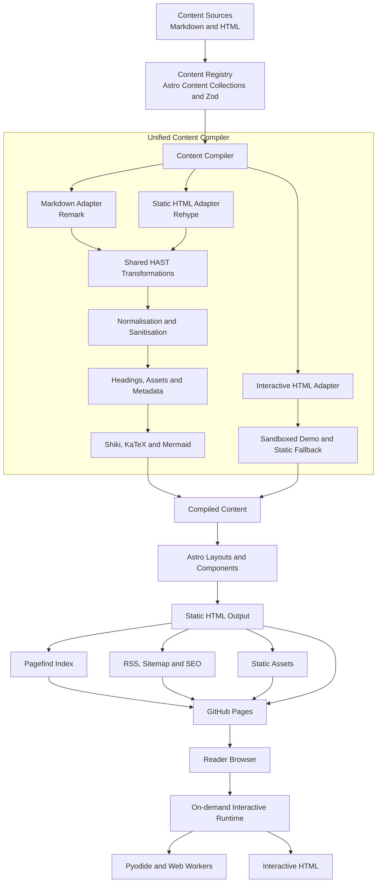
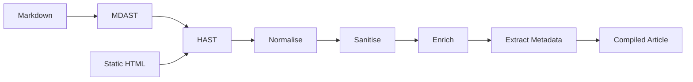
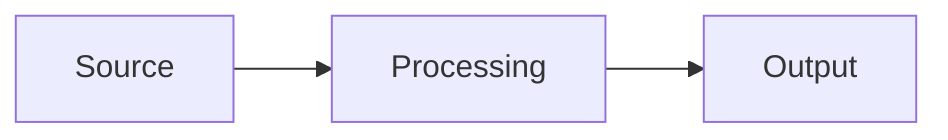
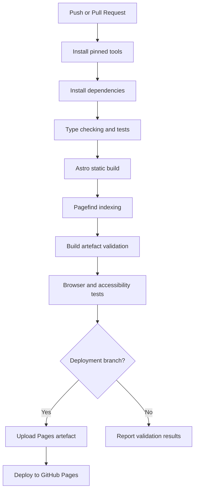

# Engineering Handoff — Cenz.Blog v2

## 1. Project Overview

**Project:** Cenz.Blog — Static Engineering Knowledge Platform

**Repository:** https://github.com/cenzwong/blog

**Production website:** https://cenzwong.github.io/blog/

**Objective:** Migrate the existing custom static site generator to Astro, introduce an extensible AST-based content compiler, and substantially improve the website's design, reading experience, search functionality and maintainability.

The website should evolve from a conventional technical blog into a static-first engineering knowledge platform capable of publishing technical articles, architecture diagrams, mathematical explanations, executable code examples and interactive demonstrations.

The migration should reduce infrastructure maintenance while increasing content capabilities.

---

## 2. Engineering Principles

All architectural and implementation decisions must follow these principles:

1. **Static-first:** Generate complete, independently accessible HTML pages at build time.
2. **Zero backend:** No application server, external database or hosted search service.
3. **Progressive enhancement:** JavaScript enhances the reading experience but is not required to read ordinary articles.
4. **Content portability:** Markdown and HTML remain the primary authoring formats.
5. **Separation of concerns:** Content storage, compilation, presentation and distribution are independent responsibilities.
6. **Build-time intelligence, runtime interactivity:** Precompute everything possible and execute only genuinely interactive functionality in the browser.
7. **Stable publication identity:** Moving source files must not change published article URLs.
8. **Minimal abstraction:** Prefer established libraries and framework capabilities over custom infrastructure.
9. **Agent-friendly development:** Maintain clear architecture, documented interfaces, reproducible commands and independently testable components.
10. **Native web standards:** Prefer semantic HTML, CSS, TypeScript, Web Components and browser APIs where appropriate.

---

## 3. Current Architecture

The existing repository contains:

| Component | Current implementation |
|---|---|
| Build tooling | Vite |
| Content ingestion | Python and PyYAML |
| Markdown renderer | Marked |
| HTML generation | Custom JavaScript generator |
| HTML sanitisation | Custom regex-based processing |
| Styling | Native CSS |
| Search | Pagefind |
| Diagrams | Client-side Mermaid |
| Mathematical notation | Client-side KaTeX |
| Syntax highlighting | Client-side Highlight.js |
| Executable Python | Pyodide and Web Workers |
| Interactive HTML | Sandboxed iframe |
| Deployment | GitHub Actions and GitHub Pages |
| Development tooling | Mise |

Important existing files:

- `scripts/ingest.py`
- `scripts/generate.mjs`
- `scripts/markdown.mjs`
- `scripts/dev.mjs`
- `scripts/validate-build.mjs`
- `src/index.css`
- `public/runtime.js`
- `public/python.worker.js`
- `docs/adr/`
- `docs/architecture.md`
- `docs/authoring.md`
- `board/`
- `AGENTS.md`

The implementation agent must inspect the latest repository state before making changes.

### Known problems

- Generated article markup uses `.article-content`, while much of the existing article CSS targets `.post-body`.
- Article title and description are duplicated when equivalent content exists in the Markdown body.
- Article tables lack sufficient spacing, borders and responsive behaviour.
- Links fall back to inconsistent browser-default styling.
- Article layouts are too wide for comfortable long-form reading.
- Search result styling does not match the generated result markup.
- Search results use absolute positioning even on the dedicated search page.
- Content discovery supports only a flat directory.
- Static HTML processing relies on insufficient regex-based sanitisation.
- Code highlighting, mathematics and diagrams depend on browser-side processing and external CDN resources.
- All Python code blocks are treated as potentially executable, including examples incompatible with Pyodide.
- Site generation, routing and metadata management require unnecessary custom infrastructure.

---

## 4. Target Architecture

Adopt Astro as the static publishing framework and Unified as the extensible content-processing ecosystem.



### Responsibility ownership

| Responsibility | Technology |
|---|---|
| Static publishing and routing | Astro |
| Content discovery and validation | Astro Content Collections and Zod |
| Markdown processing | Unified and Remark |
| HTML processing | Rehype |
| Syntax highlighting | Shiki |
| Mathematical rendering | KaTeX |
| Diagram rendering | Mermaid |
| Templates and layouts | Astro Components |
| Styling | Native CSS and design tokens |
| Full-text search | Pagefind |
| Browser interactivity | Vanilla TypeScript and browser APIs |
| Python execution | Pyodide and Web Workers |
| Package management | pnpm |
| Development environment | Mise |
| Testing | Vitest, Playwright and axe-core |
| Deployment | GitHub Actions and GitHub Pages |

Astro may internally depend on Vite. Removing Vite from the dependency graph is not a requirement. The objective is to eliminate the directly maintained custom Vite-based publishing infrastructure.

---

## 5. Scope and Non-Goals

### In scope

- Astro migration.
- Recursive content organisation.
- Unified content compiler.
- Markdown and HTML compatibility.
- Article layout redesign.
- Homepage and archive redesign.
- Dedicated search page and global quick search.
- Build-time rendering.
- Interactive article runtime.
- SEO and metadata improvements.
- Accessibility and responsive design.
- Automated testing and production deployment.
- Migration of all existing published articles.

### Out of scope

- Server-side rendering infrastructure.
- Hosted databases.
- External search services.
- Authentication and user accounts.
- Comments requiring a backend.
- Commercial CMS integration.
- Mandatory React, Vue or Svelte dependencies.
- Semantic search or embeddings for the initial migration.
- A custom Markdown language.
- Building a general-purpose static site generator.
- Unnecessary support for additional document formats.

Optional future functionality must not delay the core migration.

---

## 6. Repository Structure

Use the following as the target logical structure. Adapt implementation details to Astro's supported conventions rather than forcing unnecessary abstractions.

```text
blog/
├── content/
│   └── YYYY/
│       └── MM/
│           ├── article.md
│           ├── interactive-article.html
│           └── assets/
│
├── src/
│   ├── content.config.ts
│   │
│   ├── compiler/
│   │   ├── index.ts
│   │   ├── types.ts
│   │   ├── schema.ts
│   │   ├── loaders/
│   │   │   └── articles.ts
│   │   ├── adapters/
│   │   │   ├── markdown.ts
│   │   │   ├── html.ts
│   │   │   └── interactive-html.ts
│   │   └── plugins/
│   │       ├── normalise.ts
│   │       ├── sanitise.ts
│   │       ├── headings.ts
│   │       ├── assets.ts
│   │       ├── reading-time.ts
│   │       ├── diagrams.ts
│   │       └── executable-code.ts
│   │
│   ├── components/
│   │   ├── common/
│   │   │   ├── Header.astro
│   │   │   ├── Footer.astro
│   │   │   └── ThemeToggle.astro
│   │   ├── article/
│   │   │   ├── ArticleHeader.astro
│   │   │   ├── ArticleCard.astro
│   │   │   ├── ArticleMeta.astro
│   │   │   ├── TableOfContents.astro
│   │   │   ├── RelatedArticles.astro
│   │   │   └── InteractiveDemo.astro
│   │   └── search/
│   │       ├── SearchInput.astro
│   │       ├── SearchResults.astro
│   │       └── SearchDialog.astro
│   │
│   ├── layouts/
│   │   ├── BaseLayout.astro
│   │   └── ArticleLayout.astro
│   │
│   ├── pages/
│   │   ├── index.astro
│   │   ├── about.astro
│   │   ├── search.astro
│   │   ├── 404.astro
│   │   ├── posts/
│   │   │   └── [slug].astro
│   │   ├── archive/
│   │   │   ├── index.astro
│   │   │   └── [...date].astro
│   │   ├── tags/
│   │   │   ├── index.astro
│   │   │   └── [tag].astro
│   │   └── rss.xml.ts
│   │
│   ├── lib/
│   │   ├── articles.ts
│   │   ├── routes.ts
│   │   └── seo.ts
│   │
│   ├── runtime/
│   │   ├── search.ts
│   │   ├── search-dialog.ts
│   │   ├── theme.ts
│   │   ├── code-block.ts
│   │   ├── python-runner.ts
│   │   └── python.worker.ts
│   │
│   └── styles/
│       ├── tokens.css
│       ├── reset.css
│       ├── global.css
│       ├── typography.css
│       ├── prose.css
│       └── components.css
│
├── public/
├── scripts/
│   └── validate-build.mjs
├── tests/
│   ├── unit/
│   ├── integration/
│   ├── e2e/
│   └── fixtures/
├── docs/
│   ├── adr/
│   ├── architecture.md
│   ├── authoring.md
│   └── local-development.md
├── board/
├── .github/
│   └── workflows/
│       └── deploy.yml
├── astro.config.mjs
├── package.json
├── pnpm-lock.yaml
├── tsconfig.json
├── mise.toml
├── AGENTS.md
└── README.md
```

Avoid creating empty abstraction layers or placeholder modules solely to match this structure.

---

## 7. Content Organisation

### 7.1 Physical storage

Organise source articles using publication year and month:

```text
content/YYYY/MM/<slug>.md
content/YYYY/MM/<slug>.html
```

Example:

```text
content/2026/11/rolling-toolbox-pinned-workspace.md
```

Requirements:

- Recursively discover `.md`, `.html` and `.htm` articles.
- Exclude asset directories, drafts and non-article files.
- Migrate existing articles according to their frontmatter publication dates.
- Preserve original article content during file relocation.
- Resolve relative images and other assets against the source article location.
- Validate mismatches between directory dates and metadata dates.
- Detect duplicate slugs and output path collisions.
- Prevent asset path traversal outside permitted content roots.
- Support Unicode content.

### 7.2 Public URL structure

Physical storage must not determine the canonical article URL.

Retain:

```text
/blog/posts/<slug>/
```

Add:

```text
/blog/archive/
/blog/archive/YYYY/
/blog/archive/YYYY/MM/
/blog/tags/
/blog/tags/<tag>/
/blog/search/
/blog/about/
```

Do not introduce dates into existing article URLs.

The publication slug is a stable identifier, not a reflection of the source file's directory.

All internal URL generation must use shared route utilities and respect Astro's configured base path.

### 7.3 Backwards compatibility

Preserve:

- All existing canonical article URLs.
- Existing article slugs.
- Existing tag URLs wherever possible.
- RSS article identities.
- Legacy hash-based navigation links where currently supported.
- Existing bookmarks and external references.

Maintain explicit aliases for any intentionally renamed routes.

Do not rely on server-side redirect functionality unavailable on GitHub Pages.

---

## 8. Content Registry and Metadata

Use Astro Content Collections as the authoritative build-time registry.

Use Zod for structured metadata validation.

A custom loader may be required to support both Markdown frontmatter and existing HTML metadata comments. Astro's native Markdown loader should be preferred where it satisfies the requirements.

Avoid maintaining two competing content registries or parsing the same document through multiple independent Markdown pipelines.

### Supported metadata

```yaml
---
title: Rolling Toolbox, Pinned Workspace
description: A native-first macOS development environment.
date: 2026-11-26
updated: 2026-11-27
author: Cenz Wong
slug: rolling-toolbox-pinned-workspace

tags:
  - macOS
  - Python
  - Mise

category: Developer Tooling

draft: false
featured: false
interactive: false

series:
  name: Developer Environment
  order: 1

cover: ./assets/cover.png
---
```

Required fields:

- `title`
- `description`
- `date`
- `tags`

Optional fields:

- `slug`
- `subtitle`
- `updated`
- `author`
- `category`
- `featured`
- `draft`
- `interactive`
- `series`
- `cover`
- `aliases`

### Validation rules

- Dates must represent valid calendar dates.
- Updated dates must not precede publication dates.
- Slugs must be globally unique.
- Existing comma-separated tags must remain supported.
- Tags must be normalised consistently for filtering and routing.
- Tag normalisation must detect collisions.
- Drafts must be excluded from public articles, archives, search indices, RSS and sitemap.
- Invalid metadata must fail the build with actionable diagnostics.
- Missing optional metadata must use sensible defaults.

Publication dates must be treated as calendar dates without accidental timezone shifts.

Preserve compatibility with the existing HTML comment metadata format.

```html
<!--
title: Interactive Article
description: An interactive technical demonstration.
date: 2026-11-26
tags: Python, Performance
slug: interactive-article
interactive: true
-->
```

---

## 9. Content Compiler

### 9.1 Objective

Replace the current basic rendering implementation with a structured, extensible content compiler.

The compiler must be independent of presentation components. Astro layouts should consume compiled content rather than manually interpreting Markdown or HTML.

### 9.2 Processing ecosystem

Use the Unified ecosystem:

| Capability | Library |
|---|---|
| Markdown parsing | `remark-parse` |
| GFM extensions | `remark-gfm` |
| Markdown to HAST | `remark-rehype` |
| HTML parsing | `rehype-parse` |
| Raw HTML parsing, where explicitly enabled | `rehype-raw` |
| HTML sanitisation | `rehype-sanitize` |
| HTML serialisation | `rehype-stringify` |
| Heading identifiers | `rehype-slug` |
| Heading anchors | `rehype-autolink-headings` |
| Mathematics | `remark-math`, `rehype-katex` |
| Syntax highlighting | Shiki |
| Structured directives | `remark-directive` |
| AST traversal | `unist-util-visit` |

Use compatible stable versions and commit the dependency lockfile.

Do not implement custom parsers for functionality already provided by maintained libraries.

### 9.3 Compiler interface

Define a typed contract similar to:

```typescript
interface Heading {
  id: string;
  text: string;
  depth: number;
}

interface ContentFeatures {
  math: boolean;
  diagrams: boolean;
  codeBlocks: boolean;
  runnablePython: boolean;
  interactiveHTML: boolean;
}

interface CompiledArticle {
  html: string;
  headings: Heading[];
  readingTimeMinutes: number;
  wordCount: number;
  assets: string[];
  features: ContentFeatures;
}
```

The precise implementation may use Astro's native rendered-content representation instead of an HTML string where advantageous.

The contract must remain logically consistent across content formats.

### 9.4 Processing pipeline



Plugin ordering must be deliberate.

Sanitise untrusted authored markup before trusted transformations generate additional HTML. Ensure generated mathematical markup, syntax highlighting and diagram output are handled by an appropriate security policy.

Do not apply a permissive sanitisation configuration merely to avoid compatibility issues.

### 9.5 Content normalisation

Automatically detect and resolve:

- Duplicate leading H1 matching the metadata title.
- Duplicate introductory description matching the metadata description.
- Invalid heading hierarchy.
- Duplicate heading IDs.
- Relative article links.
- Relative image and asset paths.
- Inconsistent code block language identifiers.
- Imported HTML document wrappers.
- Unsupported elements.

Remove duplicate content only when equivalence is unambiguous.

Emit actionable warnings for ambiguous cases rather than silently rewriting meaningful content.

The final article should have one primary H1.

---

## 10. Supported Content Modes

### Mode A — Standard Markdown

Primary authoring format for technical articles.

Support:

- CommonMark.
- GitHub Flavoured Markdown.
- Tables.
- Task lists.
- Footnotes.
- Blockquotes.
- Nested lists.
- Inline code.
- Fenced code blocks.
- Mathematical notation.
- Mermaid diagrams.
- Image captions.
- Callouts.
- Explicit executable examples.

Raw HTML should remain disabled or strictly allowlisted by default.

### Mode B — Static HTML

Support existing HTML articles and imported technical documents.

Requirements:

- Parse HTML using an actual HTML parser.
- Extract appropriate document content.
- Do not insert nested document-level `html`, `head` or `body` elements into the article.
- Remove executable scripts and event handlers.
- Apply an explicit sanitisation allowlist.
- Prevent imported global styles from affecting the main website.
- Preserve meaningful tables, diagrams, headings and technical content.
- Route static HTML through shared content transformations where appropriate.
- Render using the same article layout as Markdown.

Existing HTML articles must be audited for compatibility before removing styles or elements.

### Mode C — Interactive HTML

Interactive HTML must be explicitly declared.

Requirements:

- Render executable content inside an isolated iframe.
- Preserve a meaningful static fallback for accessibility and indexing.
- Use `sandbox="allow-scripts"` as the default.
- Do not enable `allow-same-origin` without a documented security review.
- Apply restrictive content security and external resource policies.
- Do not allow interactive documents to access the parent DOM.
- Do not expose parent application credentials or storage.
- Provide accessible iframe titles.
- Load expensive demos on demand where practical.
- Handle sizing and errors without compromising isolation.

Prefer separate generated interactive documents rather than injecting executable full-document HTML into the main article.

Any communication with the parent page must use a narrowly scoped, validated messaging protocol.

---

## 11. Build-Time Rendering

Move non-interactive rendering out of the reader's browser.

| Feature | Target execution |
|---|---|
| Markdown parsing | Build time |
| HTML normalisation | Build time |
| Syntax highlighting | Build time |
| Mathematical rendering | Build time |
| Heading IDs | Build time |
| Table of contents | Build time |
| Reading time | Build time |
| Mermaid diagrams | Prefer build time |
| Search indexing | Build time |
| SEO metadata | Build time |
| Python execution | On-demand browser runtime |
| Interactive simulations | On-demand browser runtime |

### 11.1 Syntax highlighting

Use Shiki.

Requirements:

- Support common technical languages, including Python, SQL, Bash, JavaScript, TypeScript, JSON, YAML, TOML and Rust.
- Support light and dark themes.
- Preserve whitespace and indentation.
- Provide copy-to-clipboard controls.
- Display a language label where available.
- Permit horizontal scrolling for long lines.
- Support optional filenames.
- Provide a clear fallback for unsupported languages.
- Avoid unnecessary client-side syntax highlighting libraries.

### 11.2 Mathematical notation

Support inline and display mathematics:

```markdown
The time complexity is $O(n \log n)$.

$$
T(n) = 2T(n/2) + O(n)
$$
```

Render KaTeX during compilation.

Preserve accessible mathematical output, and ensure ordinary currency expressions are not incorrectly interpreted as mathematics.

### 11.3 Mermaid

Support ordinary fenced Mermaid code blocks.



Requirements:

- Prefer build-time SVG rendering.
- Use a consistent visual theme.
- Match light and dark website themes.
- Support responsive scaling.
- Preserve readable source code.
- Provide a collapsible diagram source.
- Provide horizontal scrolling or expanded viewing for large diagrams.
- Report invalid Mermaid syntax clearly.
- Maintain accessible diagram descriptions where possible.
- Avoid mandatory runtime CDN loading.

Evaluate Mermaid CLI or another maintained build-time rendering approach.

If build-time rendering is incompatible with specific diagrams or introduces disproportionate operational complexity, retain a documented, lazy-loaded runtime fallback.

### 11.4 Build artefact caching

If rendering becomes expensive, cache deterministic outputs using content hashes incorporating:

- Article source.
- Compiler configuration.
- Relevant dependency versions.
- Diagram theme configuration.

Introduce caching only where measured build performance justifies it.

---

## 12. Interactive Code Runtime

Retain the existing Pyodide and Web Worker capability, but make execution explicitly opt-in.

Display-only example:

````markdown
```python
spark.read.parquet("s3://bucket/data")
```
````

Executable example:

````markdown
```python run
print(sum(range(100)))
```
````

Optional fenced block metadata may support:

````markdown
```python run title="Calculate a sum"
print(sum(range(100)))
```
````

### Runtime requirements

- Load Pyodide only when a reader explicitly initiates execution.
- Execute Python outside the main browser UI thread.
- Provide Run, Cancel and Reset controls.
- Display stdout, stderr and execution errors.
- Clearly indicate loading and execution states.
- Allow users to terminate long-running code.
- Preserve worker state only where intentionally supported.
- Do not automatically execute code when an article loads.
- Apply suitable isolation and resource policies to executable examples.
- Avoid loading the runtime on articles without executable content.

Provide a clear notice when code requires an environment unavailable in Pyodide.

Existing runnable examples must be reviewed and annotated during migration. Ordinary Spark, AWS or infrastructure examples must remain display-only.

---

## 13. UI/UX Design System

### 13.1 Design direction

Adopt a **Minimal Editorial Engineering Journal** aesthetic.

Combine:

- AstroPaper's minimal developer-blog philosophy.
- Starlight's technical documentation readability.
- Quarto's rich technical publishing capabilities.

Use these as design references rather than mandatory framework dependencies.

The website should feel like a carefully maintained engineering publication, not a dashboard or generic SaaS landing page.

### 13.2 Visual principles

- Content-first.
- Clear visual hierarchy.
- Generous but controlled whitespace.
- Consistent typography.
- Restrained accent colours.
- Minimal decorative gradients.
- No excessive glow effects.
- No unnecessary card containers.
- Consistent interaction states.
- Responsive mobile layouts.

Preserve the existing `Cenz.Blog` branding and cyan accent identity.

### 13.3 Design tokens

Centralise tokens for:

- Backgrounds.
- Elevated surfaces.
- Primary and secondary text.
- Muted text.
- Accent colours.
- Borders.
- Typography.
- Spacing.
- Border radius.
- Shadows.
- Focus indicators.
- Motion durations.
- Container widths.

Use CSS custom properties.

Support light, dark and system themes.

Theme preferences should persist locally without requiring authentication or a backend.

Avoid an initial theme flash during page loading.

### 13.4 Typography

| Element | Target |
|---|---|
| Main container | Approximately 1200px maximum |
| Article prose | Approximately 65–75 characters per line |
| Body font | System UI or Inter |
| Monospace font | System monospace or JetBrains Mono |
| Body size | 17–18px desktop |
| Line height | Approximately 1.7–1.8 |
| Article H1 | Responsive 32–44px |
| H2 | 26–28px |
| H3 | 20–22px |
| Paragraph spacing | Approximately 1.25em |
| TOC width | Approximately 200–240px |

Treat these as design starting points and validate them using actual content.

### 13.5 Component contract

HTML structure and CSS selectors must remain aligned.

Do not preserve obsolete CSS classes that are no longer emitted by the site.

Use reusable Astro components and shared prose styles to prevent presentation divergence between content formats.

---

## 14. Homepage Redesign

The homepage should function as an entry point into the knowledge collection.

Suggested structure:

```text
┌─────────────────────────────────────────────┐
│ Cenz.Blog      Articles  Archive  About  ⌕  │
├─────────────────────────────────────────────┤
│                                             │
│ Engineering Notes.                          │
│                                             │
│ Data engineering, AI systems, software      │
│ architecture and computational thinking.    │
│                                             │
│ GitHub · RSS                                │
│                                             │
├─────────────────────────────────────────────┤
│ Explore topics                              │
│                                             │
│ Python  Data Engineering  AI  Architecture  │
│                                             │
├─────────────────────────────────────────────┤
│ Latest articles                  Archive →  │
│                                             │
│ 26 Nov 2026                                 │
│ Rolling Toolbox, Pinned Workspace           │
│ Article description...                      │
│                                             │
│ ─────────────────────────────────────────── │
│                                             │
│ PySpark Join Architecture                   │
│ Article description...                      │
│                                             │
└─────────────────────────────────────────────┘
```

Requirements:

- Replace the oversized homepage hero with a concise editorial introduction.
- Prioritise recent articles.
- Show useful metadata and descriptions.
- Provide topic discovery.
- Provide archive navigation.
- Support featured articles when explicitly configured.
- Support article series.
- Provide GitHub and RSS links.
- Avoid presenting every article as a large decorative card.
- Introduce pagination when the collection grows sufficiently large.

Preserve the existing AI-assisted knowledge synthesis philosophy in the About page rather than making it dominate the homepage.

---

## 15. Article Page Redesign

### Desktop layout

```text
┌───────────────────────────────────────────────────┐
│ Cenz.Blog                Archive  About  Search   │
├───────────────────────────────────────────────────┤
│ Articles / Developer Tooling                      │
│                                                   │
│ Rolling Toolbox, Pinned Workspace                 │
│                                                   │
│ Article description                               │
│ 26 Nov 2026 · Author · Reading time                │
│ macOS · Python · Mise                             │
├─────────────────────────────────┬─────────────────┤
│                                 │ On this page    │
│ Article introduction            │                 │
│                                 │ 1. Overview     │
│ Section heading                 │ 2. Architecture │
│                                 │ 3. Examples     │
│ Tables, diagrams, code, math    │ 4. Conclusion   │
│                                 │                 │
│ Article body                    │ View source     │
│                                 │ Share article   │
│                                 │                 │
├─────────────────────────────────┴─────────────────┤
│ Related articles                                  │
│ Previous / Next                                   │
└───────────────────────────────────────────────────┘
```

### Requirements

- Render one article title.
- Render one primary description.
- Display author, publication date and estimated reading time.
- Display updated date when available.
- Provide clickable tags.
- Automatically generate a table of contents.
- Highlight the active heading when JavaScript is available.
- Provide stable heading links.
- Provide accessible code copy controls.
- Provide a link to the article source on GitHub.
- Provide article sharing functionality.
- Display related articles based on metadata.
- Support series navigation where applicable.

### Mobile behaviour

- Convert the article to a single-column layout.
- Collapse or relocate the table of contents.
- Ensure navigation remains accessible.
- Prevent document-level horizontal overflow.
- Allow independent scrolling of wide code blocks and tables.
- Preserve readable typography and touch targets.

### Technical content styling

Define consistent styles for:

- Tables.
- Code blocks.
- Inline code.
- Images.
- Figure captions.
- Diagrams.
- Equations.
- Footnotes.
- Blockquotes.
- Callouts.
- Nested lists.
- Collapsible sections.
- Interactive examples.

Tables must have meaningful cell spacing, header differentiation, borders and responsive overflow behaviour.

---

## 16. Search Architecture and Experience

Retain Pagefind as the search engine.

Do not introduce an external search service.

Generate the search index after Astro completes static page generation.

### 16.1 Indexing policy

Index:

- Article titles.
- Descriptions.
- Headings.
- Main article prose.
- Relevant tags and categories.
- Publication metadata.

Exclude:

- Global navigation.
- Footer content.
- Related article lists.
- Duplicated metadata.
- Interactive runtime controls.
- Drafts.
- Unnecessary diagram source or generated markup that pollutes results.

Use Pagefind metadata, weighting and filtering capabilities rather than implementing a separate ranking system prematurely.

### 16.2 Dedicated search page

Route:

```text
/blog/search/
```

Support URL-based state:

```text
/blog/search/?q=pyspark&tag=python
```

Requirements:

- Search as the user types.
- Debounce search requests.
- Prevent stale asynchronous responses.
- Load the search index only when needed.
- Show meaningful loading states.
- Display correct singular and plural result counts.
- Support tag filtering.
- Support category filtering where useful.
- Display matching excerpts with safe highlighting.
- Display article title, date, description and relevant tags.
- Support heading-level links where available.
- Support keyboard navigation.
- Provide useful empty and error states.
- Synchronise search state with the URL.
- Support browser navigation and shared search links.
- Allow retry after a failed search-index load.

Do not use an absolutely positioned results container for the dedicated search page.

### 16.3 Global quick search

Provide a global search dialog accessible from every page.

Keyboard shortcut:

```text
Cmd + K
Ctrl + K
```

Requirements:

- Reuse the same Pagefind index.
- Use an accessible native dialog or equivalent implementation.
- Support arrow-key navigation.
- Support Enter to open a result.
- Support Escape to close.
- Restore focus to the invoking control.
- Display a compact set of relevant results.
- Provide access to the full search page.
- Avoid downloading the complete search index on initial page load.

The quick search should prioritise navigation. The dedicated search page should prioritise research and filtering.

### 16.4 Search security

Render excerpts safely.

Do not directly insert arbitrary result HTML into the DOM.

Allow only necessary highlighting elements and safe text.

---

## 17. Archive, Topics and Related Content

### Archive

Generate archive pages from the content registry.

```text
/archive/
/archive/2026/
/archive/2026/11/
```

Display articles grouped by year and month, ordered by publication date.

### Topics

Generate a topic index and individual tag pages.

Tag pages must use stable, collision-safe identifiers.

Provide article counts where useful.

### Related articles

Initially use deterministic metadata-based scoring:

- Shared tags.
- Shared category.
- Shared series.
- Publication or update recency as a tie-breaker.

Do not require embeddings or AI services.

### Article series

Support optional series metadata and ordered previous/next navigation.

Series should improve discovery without introducing an additional mandatory classification hierarchy.

---

## 18. SEO and Discoverability

Preserve all existing published URLs.

Configure Astro using the correct production site origin and `/blog` base path.

### Required metadata

- Unique page title.
- Meta description.
- Canonical URL.
- Open Graph metadata.
- Twitter/X card metadata.
- Publication date.
- Updated date where available.
- Author metadata.
- Appropriate page language.
- Article or BlogPosting JSON-LD.
- Breadcrumb metadata where appropriate.

### Generated resources

- RSS feed.
- Sitemap.
- Metadata catalogue, if needed for an established consumer.
- Social sharing images.
- Accessible 404 page.

### Additional requirements

- Include meaningful sitemap modification dates where available.
- Ensure sitemap URLs match canonical URLs.
- Prevent duplicate routes from entering the sitemap.
- Exclude drafts and internal demo documents from indexing.
- Consider excluding internal search pages from search-engine indexing.
- Preserve stable RSS GUIDs.
- Provide descriptive internal links.
- Ensure all important article content is visible without JavaScript.

GitHub Pages project sites are hosted under a repository subpath. A `robots.txt` file under `/blog/` is not equivalent to a domain-root robots file. Document this deployment limitation.

Submit the production sitemap through Google Search Console where applicable.

---

## 19. Performance and Dependency Policy

### Performance principles

- Deliver minimal initial JavaScript.
- Avoid a mandatory client-side framework runtime.
- Pre-render technical content.
- Lazy-load expensive interactive resources.
- Avoid fetching unrelated article bodies.
- Optimise image dimensions and formats.
- Prevent unnecessary layout shifts.
- Self-host critical assets where practical.
- Avoid unnecessary third-party CDN dependencies.

### Proposed performance targets

| Metric | Target |
|---|---|
| Lighthouse Performance | ≥ 95 |
| Lighthouse Accessibility | ≥ 95 |
| Lighthouse SEO | ≥ 95 |
| Largest Contentful Paint | ≤ 2.5 seconds |
| Interaction to Next Paint | ≤ 200 milliseconds |
| Cumulative Layout Shift | ≤ 0.1 |
| Initial first-party JavaScript | ≤ 30 KB compressed for standard articles |

Treat these as engineering targets rather than guaranteed results.

Measure representative standard articles separately from interactive demos. Use appropriate lab testing for Lighthouse and field data for real-user Core Web Vitals when sufficient traffic exists.

### Dependency policy

- Use maintained libraries.
- Avoid redundant libraries with overlapping responsibilities.
- Pin dependencies through `pnpm-lock.yaml`.
- Document significant new architectural dependencies.
- Remove superseded packages after migration verification.
- Do not introduce a large frontend framework solely for search, theme switching or navigation.

---

## 20. Development Environment

Follow the existing Rolling Toolbox, Pinned Workspace philosophy.

Mise manages project tool versions and convenience tasks. Standard package-manager workflows must continue to work without Mise.

Use:

- Node.js.
- pnpm.
- TypeScript.
- Astro CLI.

Provide conventional scripts:

```bash
pnpm install
pnpm dev
pnpm build
pnpm preview
pnpm test
pnpm check
pnpm lint
```

Provide corresponding Mise tasks:

```bash
mise install
mise run dev
mise run build
mise run preview
mise run test
mise run check
```

Mise tasks should delegate to standard project commands rather than duplicate their implementation.

The project must remain usable by contributors who have not installed Mise.

Pin compatible Node.js and pnpm versions.

Remove Python build dependencies after confirming no retained functionality depends on them. Browser-based Python execution through Pyodide remains supported.

---

## 21. GitHub Actions and Deployment

Maintain GitHub Pages deployment.

Target pipeline:



Requirements:

- Use frozen dependency installation in CI.
- Validate pull requests before merging.
- Deploy only from the configured production branch.
- Generate Pagefind after Astro static output exists.
- Preserve the GitHub Pages base path.
- Validate generated routes.
- Validate internal links and assets.
- Ensure generated assets are deployed completely.
- Prevent publication of drafts.
- Verify the production build rather than relying solely on development-server behaviour.

The production deployment must not require a Node.js or Python server.

---

## 22. Testing Strategy

### 22.1 Unit tests

Cover:

- Metadata validation.
- Recursive content discovery.
- Slug generation.
- Tag normalisation.
- Duplicate detection.
- Route generation.
- Relative asset resolution.
- Reading-time calculation.
- Heading extraction.
- Duplicate title removal.
- Markdown transformations.
- Static HTML sanitisation.
- Executable code metadata.

### 22.2 Compiler fixtures

Maintain representative fixtures for:

- Standard Markdown.
- GFM tables.
- Nested lists.
- Footnotes.
- Mermaid diagrams.
- Inline and display mathematics.
- Code blocks.
- Duplicate headings.
- Relative images.
- Complete HTML documents.
- HTML fragments.
- Interactive HTML.
- Unsafe HTML.
- Invalid metadata.
- Unicode content.
- Draft articles.

Use snapshots selectively to detect unintended changes in compiled output.

### 22.3 Integration tests

Verify:

- Every existing article has a corresponding generated route.
- Canonical URLs remain unchanged.
- Static content is generated without requiring browser JavaScript.
- Archive counts match the published registry.
- Tag pages contain the correct articles.
- RSS and sitemap contain the correct published URLs.
- Drafts are excluded.
- Pagefind assets are generated.
- Interactive documents use the correct isolation policy.

### 22.4 Browser tests

Use Playwright to test:

- Homepage navigation.
- Article rendering.
- Desktop and mobile layouts.
- Theme switching.
- Table of contents.
- Heading links.
- Code copying.
- Search results.
- Search filters.
- Search URL state.
- Quick search keyboard shortcuts.
- Python execution.
- Python cancellation.
- Interactive HTML.
- 404 behaviour.
- Legacy link compatibility.

### 22.5 Accessibility

Use axe-core and manual checks for:

- Semantic landmarks.
- Keyboard-only navigation.
- Visible focus indicators.
- Colour contrast.
- Accessible dialogs.
- Heading hierarchy.
- Screen-reader labels.
- Image descriptions.
- Reduced-motion preferences.
- Mobile touch targets.

Target WCAG 2.2 AA.

### 22.6 Visual regression

Capture representative screenshots covering:

- Homepage.
- Markdown article.
- HTML article.
- Article containing tables.
- Article containing mathematical notation.
- Article containing Mermaid diagrams.
- Search page.
- Quick search dialog.
- Archive.
- Mobile layouts.
- Light and dark themes.

Visual regression checks must verify actual article rendering rather than isolated mock components only.

---

## 23. Migration and Compatibility Strategy

Before modifying existing publishing infrastructure:

1. Inspect repository documentation, ADRs and AGENTS.md.
2. Inventory all published articles.
3. Record existing slugs and canonical routes.
4. Identify interactive HTML content.
5. Identify Python examples that genuinely require execution.
6. Capture representative screenshots.
7. Record baseline build output and performance.
8. Identify any content or features depending on existing custom scripts.

Create a compatibility manifest mapping every existing article to its target source path and public URL.

Perform the migration incrementally.

Do not remove existing scripts until their replacements pass compatibility tests.

Potentially retired components include:

```text
scripts/ingest.py
scripts/generate.mjs
scripts/markdown.mjs
scripts/dev.mjs
vite.config.js
index.html
requirements.txt
package-lock.json
```

Retirement is conditional on successful replacement and verification.

Preserve relevant runtime code, tests and documentation rather than rewriting them unnecessarily.

---

## 24. Delivery Roadmap

### Epic 1 — Foundation and Compatibility

- Audit the current repository.
- Inventory existing content and routes.
- Introduce Astro static output.
- Configure TypeScript and pnpm.
- Configure Mise tasks.
- Establish content registry.
- Verify GitHub Pages base-path compatibility.
- Create migration fixtures.

**Exit condition:** Astro can generate representative existing articles at their original URLs.

### Epic 2 — Content Compiler

- Introduce Unified processing.
- Implement Markdown adapter.
- Implement static HTML adapter.
- Implement interactive HTML adapter.
- Establish sanitisation policy.
- Add metadata validation.
- Implement content normalisation.
- Generate headings and reading time.
- Add compiler tests.

**Exit condition:** All existing content formats compile correctly and safely.

### Epic 3 — Content Organisation

- Implement recursive discovery.
- Migrate content into YYYY/MM.
- Resolve relative assets.
- Preserve article slugs.
- Generate archive routes.
- Validate compatibility manifest.

**Exit condition:** All published content is discoverable without changing existing canonical URLs.

### Epic 4 — Design System and Reading Experience

- Implement design tokens.
- Implement shared layouts.
- Redesign navigation and homepage.
- Redesign article pages.
- Implement prose styling.
- Add table of contents.
- Implement light and dark themes.
- Implement responsive layouts.

**Exit condition:** Representative articles render consistently across desktop and mobile.

### Epic 5 — Rich Technical Content

- Integrate Shiki.
- Integrate build-time KaTeX.
- Integrate Mermaid rendering.
- Implement code-copy controls.
- Implement explicit executable Python blocks.
- Preserve interactive HTML.
- Implement callouts and supported directives.

**Exit condition:** Technical content renders correctly without unnecessary runtime dependencies.

### Epic 6 — Search and Discovery

- Integrate Pagefind post-build indexing.
- Redesign the dedicated search page.
- Implement global quick search.
- Implement search metadata and filtering.
- Implement URL-based search state.
- Implement tag and series navigation.
- Improve related article selection.

**Exit condition:** Search is functional, accessible, shareable and fully static-hosting compatible.

### Epic 7 — Production Hardening

- Implement SEO metadata.
- Generate RSS and sitemap.
- Add social sharing images.
- Add browser and accessibility tests.
- Add visual regression tests.
- Add performance checks.
- Update GitHub Actions.
- Validate all published routes.
- Remove obsolete infrastructure.

**Exit condition:** The complete migration passes production-readiness checks.

### Epic 8 — Documentation and Release

- Update architecture documentation.
- Update authoring documentation.
- Update local development documentation.
- Record architectural decisions.
- Update AGENTS.md.
- Complete outstanding migration tickets.
- Prepare release notes and rollback instructions.

**Exit condition:** Another engineer or agent can maintain and extend the platform independently.

---

## 25. Project Management and Agent Workflow

The receiving agent must first convert this handoff into an actionable implementation backlog.

Use the existing repository board conventions.

Suggested task structure:

```text
board/
├── backlog/
├── ready/
├── in_progress/
├── review/
└── done/
```

Adapt these directories to existing conventions where appropriate.

Each task should contain:

- Task ID.
- Objective.
- Context.
- Dependencies.
- Scope.
- Implementation requirements.
- Acceptance criteria.
- Testing requirements.
- Relevant files.
- Architectural decisions.
- Risks.

Tasks should be small enough to implement and verify independently.

Do not create one oversized task covering the entire migration.

Record significant architectural changes in ADRs, including:

- Astro framework selection.
- Unified compiler architecture.
- Physical content organisation versus canonical routing.
- HTML trust and sanitisation policy.
- Build-time diagram rendering.
- Pagefind search architecture.
- Interactive execution isolation.
- Package management and development tooling.

Mark superseded ADRs appropriately while retaining their historical context.

---

## 26. Definition of Done

The migration is complete when all of the following are satisfied.

### Architecture

- [ ] Astro replaces the custom static site generator.
- [ ] Unified provides the content-processing foundation.
- [ ] Markdown and HTML remain supported.
- [ ] Content compilation and presentation are separated.
- [ ] No application backend is required.
- [ ] Superseded infrastructure is removed.

### Content

- [ ] Existing articles are migrated to YYYY/MM.
- [ ] Existing canonical article URLs remain unchanged.
- [ ] Relative links and assets resolve correctly.
- [ ] Metadata validation is comprehensive.
- [ ] Duplicate article headings are resolved.
- [ ] Drafts are excluded from all public outputs.

### Reader experience

- [ ] Homepage uses the new editorial design.
- [ ] Article typography is consistent and readable.
- [ ] Tables, diagrams, code and mathematics render correctly.
- [ ] Table of contents is generated automatically.
- [ ] Light, dark and system themes work.
- [ ] Mobile layouts are responsive.
- [ ] Navigation is accessible.

### Search

- [ ] Pagefind indexes the generated articles.
- [ ] Dedicated search page is redesigned.
- [ ] Global quick search works.
- [ ] Search supports relevant metadata and filtering.
- [ ] Search URLs are shareable.
- [ ] Search results render safely.

### Interactive features

- [ ] Explicit Python examples execute on demand.
- [ ] Workers support cancellation and reset.
- [ ] Interactive HTML remains functional and isolated.
- [ ] Ordinary articles require no interactive runtime.
- [ ] Static fallbacks remain accessible.

### Production quality

- [ ] All existing article routes pass compatibility tests.
- [ ] RSS and sitemap are valid.
- [ ] SEO metadata is correct.
- [ ] Accessibility checks pass agreed thresholds.
- [ ] Representative visual regression tests pass.
- [ ] Performance targets are measured and reported.
- [ ] GitHub Actions deploys successfully.
- [ ] Documentation reflects the final implementation.

---

## 27. Future Extension Points

The architecture should allow future capabilities without implementing them during the core migration.

Potential extensions:

- D2 architecture diagrams.
- Vega-Lite declarative visualisations.
- Observable Plot.
- Interactive SQL using DuckDB-Wasm or PGlite.
- Bibliography and citation processing.
- Jupyter notebook import.
- Obsidian-compatible authoring extensions.
- Local semantic search.
- Related article recommendations using embeddings.
- Browser-based WebAssembly demonstrations.
- Reusable interactive Web Components.
- Offline article availability.

Each future capability should be introduced through an explicit adapter, compiler extension or runtime module rather than modifying the entire publishing pipeline.

Do not build speculative infrastructure for these extensions.

---

## 28. Implementation Decisions and Validation Gates

The following decisions are established for the migration:

| Decision | Selected approach |
|---|---|
| Publishing framework | Astro |
| Content compiler | Unified / Remark / Rehype |
| Source organisation | YYYY/MM |
| Public article URLs | Preserve existing slug-based routes |
| Primary content formats | Markdown and HTML |
| Search engine | Pagefind |
| UI implementation | Astro Components and native CSS |
| Code highlighting | Shiki |
| Mathematics | Build-time KaTeX |
| Diagrams | Prefer build-time Mermaid |
| Interactive Python | Opt-in Pyodide workers |
| Interactive HTML | Isolated sandbox |
| Hosting | GitHub Pages |
| Package manager | pnpm |
| Developer tooling | Mise-compatible standard workflows |

The following must be validated during initial implementation:

- Compatibility between the selected stable Astro version and Unified integration.
- Whether native Astro Markdown processing or a custom compiler adapter best satisfies the shared content contract.
- Compatibility of existing complete HTML documents with the sanitised static HTML adapter.
- Mermaid build-time rendering reliability within GitHub Actions.
- Interactive HTML asset resolution and isolation.
- Compatibility of existing runnable Python examples.
- Actual build performance and browser performance.

Do not assume that every proposed integration works without a compatibility proof of concept.

Where a selected implementation proves unsuitable, document the trade-off, choose the simplest compatible alternative and preserve the architectural principles.

---

## 29. Final Instruction to the Receiving Agent

Treat this migration as a production engineering project rather than a cosmetic redesign.

Start by inspecting the existing repository, identifying compatibility requirements and producing the implementation backlog.

Reuse working components wherever possible. Replace obsolete infrastructure deliberately. Do not over-engineer the content compiler or introduce unnecessary frontend dependencies.

Every implementation task must contribute to a verifiable improvement in maintainability, content capability, security, performance or reader experience.

The final result should be a clean, extensible, static-first engineering knowledge platform where Markdown and HTML remain portable source formats, Astro owns publishing infrastructure, Unified owns content transformation, and browser runtimes are reserved for genuinely interactive functionality.

**Core philosophy:**

> Content is portable. Compilation is extensible. Presentation is consistent. Infrastructure is static. Interactivity is intentional.
